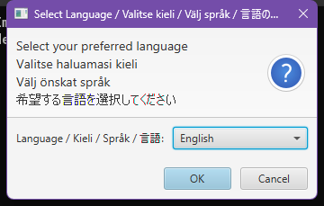
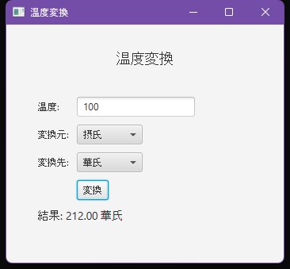
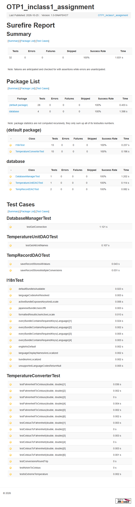
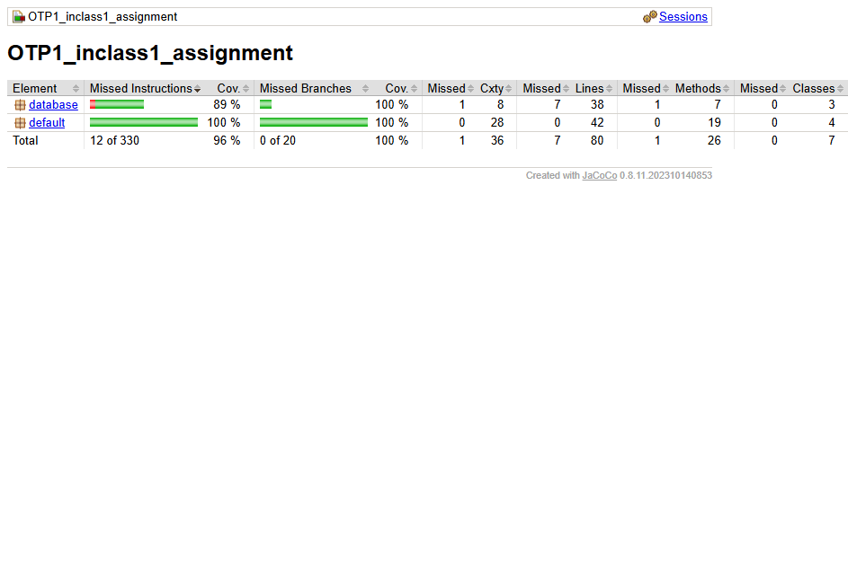
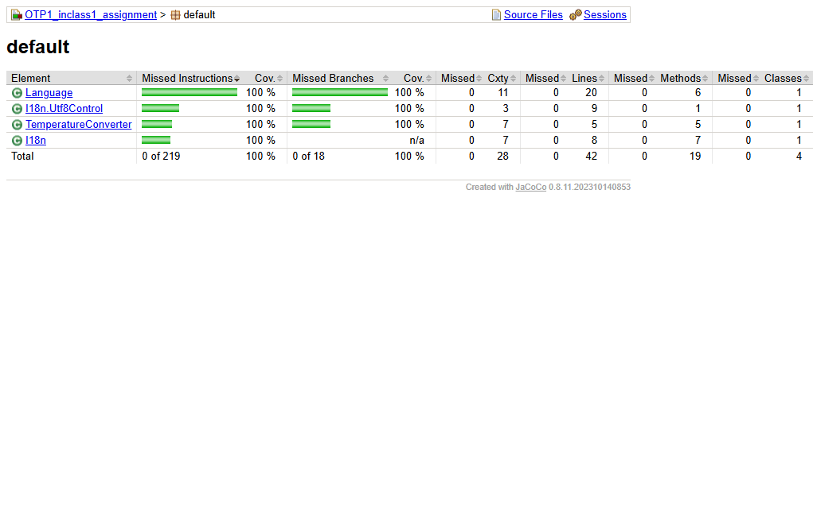

# Temperature Converter

## 1. Assignment Description

This project implements a temperature conversion application with a graphical user interface. The application allows the user to enter a temperature value, select the original unit, select the target unit, and view the converted result.

The supported temperature units are:

- Celsius
- Fahrenheit
- Kelvin

The application also stores conversion records in a local H2 database.

### Main requirements addressed

- Implement a graphical user interface for temperature conversion.
- Support conversions between Celsius, Fahrenheit, and Kelvin.
- Provide a localized user interface in English, Finnish, Swedish, and Japanese.
- Load the user interface texts from UTF-8 encoded resource bundles.
- Validate numeric user input.
- Display the converted temperature with two decimal places.
- Store temperature conversion records in a database.
- Initialize the database automatically when the application starts.
- Provide automated unit tests for the conversion logic, localization, and database functionality.
- Provide Maven, Docker, and Jenkins-based build and verification support.

## 2. Technologies & Tools Used

### Programming languages

- Java 17
- HTML
- JavaScript
- CSS
- Groovy, for the Jenkins pipeline

### Libraries and frameworks

- JavaFX 21.0.2
    - `javafx-controls`
    - `javafx-fxml`
    - `javafx-graphics`
    - `javafx-base`
- H2 Database 2.2.224
- JUnit Jupiter 5.13.4
- JaCoCo 0.8.11
- Java `ResourceBundle` / `PropertyResourceBundle` for localization

### Development and build tools

- Apache Maven 3.9 or newer
- Java Development Kit 17
- Docker
- Jenkins
- Git and GitHub
- IntelliJ IDEA project configuration

## 3. Design Approach & Implementation Method

### Application structure

The application is divided into four main areas:

1. Graphical user interface
2. Localization
3. Temperature conversion logic
4. Database access

The main application classes are located in `src/main/java`. The localized messages are located in `src/main/resources`.

### Graphical user interface

The GUI is implemented using JavaFX. At launch, the application displays a language selection dialog with the following options:

- English
- Finnish (Suomi)
- Swedish (Svenska)
- Japanese (日本語)

After the language has been selected, the application window contains:

- A text field for entering the temperature value
- A unit selector for the original temperature unit
- A unit selector for the target temperature unit
- A conversion button
- A label for displaying the result or an error message

All labels, prompts, buttons, window titles, unit names, and error messages are loaded from the selected resource bundle.

The application starts from the `Launcher` class, which starts `TempConverterApp`.

The main JavaFX application initializes the database before displaying the user interface. The available temperature units are loaded from the database through `TemperatureUnitDAO`.

### Localization

Localization is implemented with Java `ResourceBundle` and `PropertyResourceBundle`. The bundles are always read as UTF-8 by a custom `ResourceBundle.Control`, so the Japanese texts do not need Unicode escape sequences.

The project contains the following UTF-8 properties files:

| File | Language |
|---|---|
| `MessagesBundle_en_US.properties` | English (default) |
| `MessagesBundle_fi_FI.properties` | Finnish |
| `MessagesBundle_sv_SE.properties` | Swedish |
| `MessagesBundle_ja_JP.properties` | Japanese |
| `MessagesBundle.properties` | English fallback |

The `Language` enum defines the supported locales. The `I18n` class loads the bundle for the selected locale and exposes the localized strings and locale-aware formatting to the UI.

### Temperature conversion

The conversion logic is implemented in the `TemperatureConverter` class. The following conversions are supported:

- Fahrenheit to Celsius
- Celsius to Fahrenheit
- Kelvin to Celsius
- Detection of extreme Celsius temperatures

The GUI supports conversion between all three units by first converting the input value to Celsius and then converting the Celsius value to the selected target unit. The GUI delegates the actual formulas to `TemperatureConverter`.

Temperature values are displayed using two decimal places and the number formatting conventions of the selected locale.

### Database design

The application uses an H2 file-based database stored in the `data` directory.

The database contains two tables:

#### `temperature_unit`

Stores the supported temperature units.

| Column | Description |
|---|---|
| `id` | Unique identifier |
| `name` | Name of the temperature unit |
| `symbol` | Symbol of the temperature unit |

The database is automatically populated with:

- Celsius
- Fahrenheit
- Kelvin

#### `temperature_record`

Stores completed temperature conversions.

| Column | Description |
|---|---|
| `id` | Unique identifier |
| `input_value` | Original temperature value |
| `from_unit_id` | Original temperature unit |
| `to_unit_id` | Target temperature unit |
| `result` | Converted temperature |
| `recorded_at` | Time of the conversion |

### Database access

Database operations are separated into DAO classes:

- `TemperatureUnitDAO` retrieves temperature unit names.
- `TempRecordDAO` saves conversion records.
- `DatabaseManager` creates the database connection and initializes the database tables.

Prepared statements are used when storing conversion records.

### Build and deployment approach

Maven is used to:

- Compile the Java source code
- Download project dependencies
- Copy the UTF-8 resource bundles into the application
- Run automated tests
- Generate JaCoCo code coverage reports
- Enforce 100% line and branch coverage for `TemperatureConverter`
- Build an executable shaded JAR file

A Dockerfile is included to create a containerized version of the application. The Docker build uses a multi-stage build, runs `mvn clean verify` (including tests and JaCoCo checks), and packages the application together with its dependencies. The runtime image uses a UTF-8 locale so the localized texts are handled correctly.

A Jenkins pipeline is also included. It performs the following stages:

1. Checkout
2. Build and test (`mvn clean verify`)
3. Publish test results
4. Publish coverage results
5. Archive the JaCoCo report
6. Build the Docker image
7. Verify the Docker image
8. Publish the image to Docker Hub

## 4. Testing & Quality Assurance Steps

### Automated tests

The project uses JUnit 5 for automated testing.

The tests cover the following functionality:

| Test area | Test scenarios | Expected result |
|---|---|---|
| Fahrenheit-to-Celsius conversion | `32°F`, `212°F`, `-40°F`, `0°F`, `98.6°F`, `451°F` | Correct Celsius values are returned |
| Celsius-to-Fahrenheit conversion | `0°C`, `100°C`, `-40°C`, `37°C`, `-273.15°C`, `50°C` | Correct Fahrenheit values are returned |
| Conversion round-trip | Several Celsius values converted to Fahrenheit and back | The original value is returned within the tolerance |
| Kelvin-to-Celsius conversion | `300 K`, `273.15 K`, and `0 K` | Correct Celsius values are returned |
| Extreme temperature detection | Boundary values `-40` and `50`, edge cases `-41` and `51`, and interior values | Correctly identifies extreme temperatures |
| Localization bundles | All four locales | Every bundle contains all required UI keys |
| UTF-8 encoding | Japanese bundle | Japanese texts are read correctly without Unicode escapes |
| Language selection | Language codes such as `ja_JP`, `fi-FI`, and `sv_SE` | Correct `Language` value is resolved |
| Locale-aware formatting | English and Finnish result patterns | Decimal separators follow the active locale |
| Database connection | Initialize the database and request a connection | A valid database connection is returned |
| Temperature unit DAO | Retrieve available temperature units | Three units are returned in the expected order |
| Temperature record DAO | Save one or more conversions and read them back | All values and timestamps are stored correctly |

The test suite contains 32 JUnit 5 tests. The temperature conversion tests use a tolerance of `0.001` to account for floating-point calculation differences.

JaCoCo enforces 100% line and branch coverage for `TemperatureConverter`. The generated report currently shows 100% line and branch coverage for the default package and 96% instruction / 100% branch coverage overall. The JavaFX entry points (`TempConverterApp` and `Launcher`) are excluded from the coverage report because they require a display; they are verified manually.

### Manual testing

The graphical user interface can be tested manually using the following scenarios:

1. Enter a valid Celsius value and convert it to Fahrenheit.
2. Enter a valid Fahrenheit value and convert it to Celsius.
3. Enter a valid Kelvin value and convert it to Celsius.
4. Convert a temperature between all supported unit combinations.
5. Leave the input empty and click **Convert**.
6. Enter non-numeric input and click **Convert**.
7. Confirm that an error message is displayed for invalid input.
8. Confirm that valid conversions are displayed with two decimal places.
9. Confirm that a conversion creates a record in the H2 database.

### Build verification

The following Maven commands are used for quality assurance:

```bash
mvn clean verify
mvn test
mvn jacoco:report
```

`mvn clean verify` runs the tests, generates the JaCoCo report, checks the coverage rules, and builds the shaded JAR. The coverage report is written to `target/site/jacoco/index.html`, and the Surefire report is written to `target/reports/surefire.html`.

The Maven build also creates a shaded JAR containing the application and its dependencies.

## 5. How to Run

### Prerequisites

Install the following software:

- JDK 17 or newer
- Apache Maven 3.9 or newer
- Git

For the Docker option:

- Docker Desktop or Docker Engine

### Clone the repository

```bash
git clone https://github.com/mwxzy/Ohjelmistotuotantoprojekti1.git
cd Ohjelmistotuotantoprojekti1
```

### Run the automated tests

```bash
mvn test
```

### Build the application

```bash
mvn clean verify
```

The generated JAR file is created in the `target` directory.

### Run the application with Maven

On Windows, run:

```bash
mvn javafx:run
```

The Maven configuration uses the Windows JavaFX platform by default.

On Linux, use:

```bash
mvn -Djavafx.platform=linux javafx:run
```

When the application starts, select the language from the dialog. The default is English.

### Run the packaged JAR

After building the project, run:

```bash
java -jar target/OTP1_inclass1_assignment-1.0-SNAPSHOT.jar
```

The language dialog is shown at launch. For automated or non-interactive runs, the language can be selected with a system property or a command-line argument:

```bash
java -Dapp.locale=ja_JP -jar target/OTP1_inclass1_assignment-1.0-SNAPSHOT.jar
java -jar target/OTP1_inclass1_assignment-1.0-SNAPSHOT.jar --lang=fi_FI
```

Supported language codes are `en_US`, `fi_FI`, `sv_SE`, and `ja_JP` (the short forms `en`, `fi`, `sv`, and `ja` are also accepted).

### Build and run with Docker

Build the Docker image:

```bash
docker build -t temperature-converter-gui .
```

The Docker build runs the unit tests, generates the JaCoCo report, and verifies the coverage rules before packaging the application.

Run the container (a display/X11 socket is required for the JavaFX GUI):

```bash
docker run --rm -e DISPLAY=$DISPLAY -v /tmp/.X11-unix:/tmp/.X11-unix temperature-converter-gui
```

The Docker image uses Java 17 and installs the native libraries required by JavaFX. The runtime container uses a UTF-8 locale for the localized texts.

## 6. Assignment Screenshots

The `docs` directory contains screenshots produced from the final build:

### Language selection at launch



### Japanese localized application



### Successful test execution



### JaCoCo coverage report



### JaCoCo default package details



## Project Structure

```text
.
├── data/
│   ├── tempconverter.mv.db
│   └── tempconverter.trace.db
├── docs/
│   ├── jacoco-coverage.png
│   ├── jacoco-default-package.png
│   ├── language-selection.png
│   ├── localization-ja.png
│   └── surefire-tests.png
├── src/
│   ├── main/
│   │   ├── java/
│   │   │   ├── I18n.java
│   │   │   ├── Language.java
│   │   │   ├── Launcher.java
│   │   │   ├── TempConverterApp.java
│   │   │   ├── TemperatureConverter.java
│   │   │   └── database/
│   │   │       ├── DatabaseManager.java
│   │   │       ├── TempRecordDAO.java
│   │   │       └── TemperatureUnitDAO.java
│   │   └── resources/
│   │       ├── MessagesBundle.properties
│   │       ├── MessagesBundle_en_US.properties
│   │       ├── MessagesBundle_fi_FI.properties
│   │       ├── MessagesBundle_sv_SE.properties
│   │       └── MessagesBundle_ja_JP.properties
│   └── test/
│       └── java/
│           ├── I18nTest.java
│           ├── TemperatureConverterTest.java
│           └── database/
│               ├── DatabaseManagerTest.java
│               ├── TemperatureUnitDAOTest.java
│               └── TempRecordDAOTest.java
├── .dockerignore
├── Dockerfile
├── Jenkinsfile
├── pom.xml
└── README.md
```